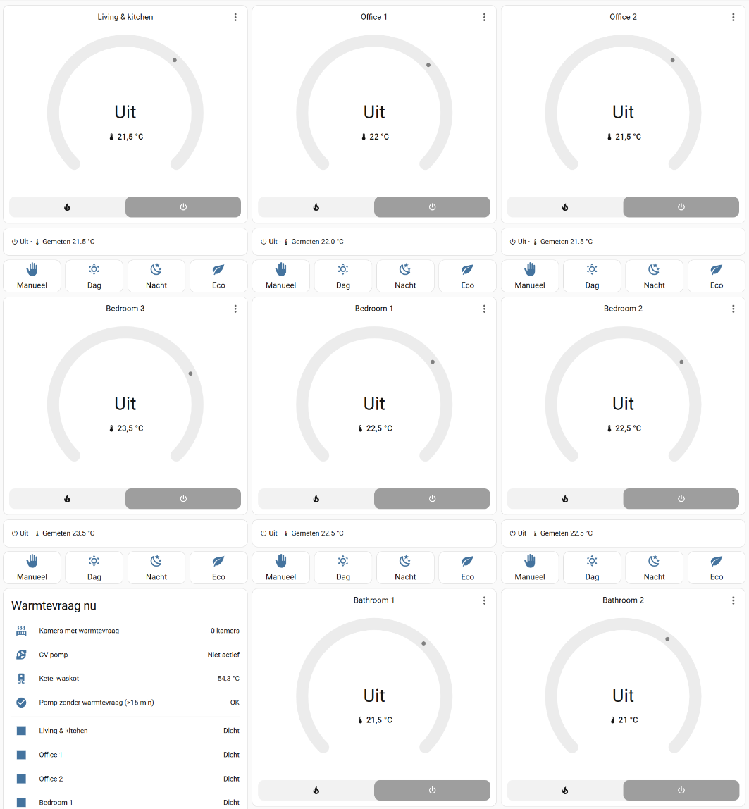
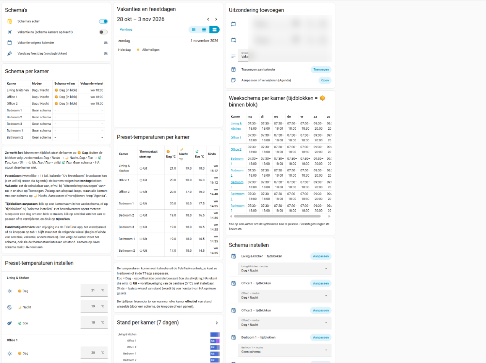

# Heating: TeleTask room thermostats with schedules in Home Assistant

Control all TeleTask room thermostats (Aurus wall panels) from Home Assistant and replace the TeleTask app:
presets, setpoints, preset temperatures, week schedules per room, public holidays and vacations, plus heat
demand and pump statistics. The TeleTask central keeps driving valves, pump and boiler itself, so heating keeps
working when Home Assistant is down.

| Rooms | Schedules |
|---|---|
|  |  |

*Screenshots from the author's installation (Dutch preset labels; room names anonymised). The generated
dashboard uses English labels.*

## What you get

- **Rooms tab:** a thermostat card per room with a status line (target, measured, preset, heating/idle) and preset
  buttons, heat demand per room (valve relays), pump status, room temperatures and today's pump runtime.
- **Charts tab:** preset and heat demand timelines, boiler/pump and per-room temperature vs. target charts.
- **Schedules tab:**
  - a **Schedule helper per room** with day blocks, edited in Home Assistant's week editor (click a room);
  - a **mode per room**: `Day / Night`, `Day / Eco`, `On / Off`, `Eco / Eco` (inside / outside the blocks) or
    `No schedule` (Home Assistant leaves the room alone);
  - **public holidays** (Workday integration + a "Heating holidays" calendar for e.g. bridge days): rooms follow
    their **Sunday** blocks;
  - **vacation** (a switch or an event in the "Heating exceptions" calendar, added from the dashboard): all
    scheduled rooms on **night**; optionally a TeleTask flag for a message on the wall panels;
  - **preset temperatures** (day / night / eco) per room, read and set from Home Assistant.

**Manual override:** a change on a wall panel, in the TeleTask app or with the dashboard buttons stays until the
next switch (start or end of a block, vacation, other mode). Then the room follows its schedule again.

## Requirements

- [jeletask2mqtt](https://github.com/ridiekel/jeletask) with the room sensors as `TEMPERATURECONTROL`, see
  [`jeletask-config-example.json`](jeletask-config-example.json). Use preset labels in `ha_preset_modes` that
  match `preset_labels` in `rooms.yaml`.
- Presets per room, `hvac_action`, and **setting preset temperatures** come from
  [ridiekel/jeletask#67](https://github.com/ridiekel/jeletask/pull/67). Until that is released, use an image built
  from that branch, or leave out the "Set preset temperatures" card (reading them works without it).
- Valve relays and the pump as `"type": "SWITCH"` (as `binary_sensor` they stay unknown, see
  [ridiekel/jeletask#68](https://github.com/ridiekel/jeletask/issues/68)).
- Home Assistant 2025.x or newer with packages enabled, the **Workday** integration for your country, and the
  [apexcharts-card](https://github.com/RomRider/apexcharts-card) (HACS) for the charts tab.

## Installation

1. Describe your rooms in [`rooms.yaml`](rooms.yaml) and generate the files (Python 3.9+ with PyYAML):

   ```bash
   pip install pyyaml
   python generate.py
   ```

   This writes `output/heating_package.yaml` and `output/heating_dashboard.yaml`. The files in `output/` are the
   result for the example rooms.
2. Enable packages in `configuration.yaml` and copy the package:

   ```yaml
   homeassistant:
     packages: !include_dir_named packages
   ```

   `/config/packages/heating_package.yaml`, then restart Home Assistant.
3. Create in the UI (Settings → Devices & services → Helpers / Integrations):
   - a **Schedule** helper per room named `Heating <room name>` (e.g. `Heating Living & kitchen` →
     `schedule.heating_living_kitchen`); add the day blocks;
   - two **Local Calendar** integrations: `Heating exceptions` (vacations) and `Heating holidays` (extra
     holidays, bridge days);
   - the **Workday** integration for your country, and set `workday_sensor` in `rooms.yaml` to its entity.
4. New dashboard with URL `heating` (or the `dashboard_path` from `rooms.yaml`) → ⋮ → Edit → ⋮ → Raw
   configuration editor → paste `output/heating_dashboard.yaml`.
5. Turn on **Heating schedules active**, choose a mode per room and test one room first.

## How it works

- A trigger-based template sensor runs every minute: `schedule.get_schedule` → `binary_sensor.heating_in_block_<room>`
  (with the Sunday blocks on a public holiday) and `sensor.heating_schedules` (the week table on the dashboard).
- The automation `heating_schedule_control` only acts on changes of those sensors, the modes, vacation and at start,
  and only sends a preset when it differs. A thermostat that is off is turned on first.
- Preset temperatures go to the central with the jeletask2mqtt actions `DAY_PRESET`, `NIGHT_PRESET` and `ECO_OFFSET`;
  the central stores eco as an offset below day, Home Assistant shows and sets it as a temperature.

## Gotchas

- `schedule.get_schedule` returns `from`/`to` as **time objects** in automations and trigger templates (they look
  like strings in the template editor): use `| string` before slicing. An end of 24:00 is `23:59:59`.
- Home Assistant takes a while to start; triggers during startup are lost. The automation also runs at start.
- Switching a sensor from `TEMPERATURE` to `TEMPERATURECONTROL` replaces `sensor.…` by `climate.…`; the package's
  `sensor.heating_temperature_<room>` gives you a temperature sensor for history again.
- An empty "Settings" dialog when opening a schedule = an old frontend in the browser cache: Ctrl+Shift+R.
